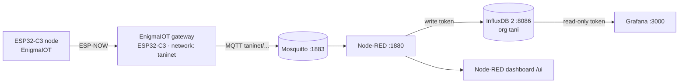

# SecureLowPowerIoT 
# TaniNet — Precision Agriculture IoT Stack

SECURE LOW POWER MULTI NODE  PRECISION AGRICULTURE NETWORK  USING RISC-V ESP32

Self-hosted monitoring platform for precision agriculture:

**ESP32-C3 sensor nodes (EnigmaIOT) → EnigmaIOT gateway → Mosquitto → Node-RED → InfluxDB 2 → Grafana**

|Component|Role|Port|
|---|---|---|
|**EnigmaIOT nodes** (ESP32-C3)|Read sensors, send encrypted data over ESP-NOW|–|
|**EnigmaIOT gateway** (ESP32-C3)|Receives ESP-NOW, publishes to MQTT under the network name `taninet`|–|
|**Mosquitto**|MQTT broker|`1883`|
|**Node-RED**|Subscribes to MQTT, writes to InfluxDB, operator dashboard (`/ui`)|`1880`|
|**InfluxDB 2**|Time-series database|`8086`|
|**Grafana**|Dashboards, reads InfluxDB with a read-only token|`3000`|

## 🧭 Naming used in this guide

|Item|Value|
|---|---|
|EnigmaIOT network name (MQTT topic root)|`taninet`|
|InfluxDB organization|`tani`|
|InfluxDB user|`tani`|
|Bucket for sensor data|`tani_bucket` (measurement `sensordata`)|
|Bucket for node / gateway status|`Status` (measurements `nodestatus`, `gatewaystatus`)|
|Server IP (example)|`192.168.1.20` — replace with yours|

> The old placeholder bucket `agri_raw` is replaced by `tani_bucket`. Bucket names are case-sensitive (`Status` ≠ `status`).

---

## 🗂️ Repository structure

```
taninet/
├── README.md
├── ESP32C3/                 # EnigmaIOT firmware for ESP32-C3: sensor node + gateway
├── ina219Measurement/       # Arduino sketch: power measurement with an INA219
├── nodered/                 # Node-RED flow file (flows.json)
└── grafanadashboard/        # Grafana dashboard (existing JSON export)
```

|Folder|Content|Section|
|---|---|---|
|`ESP32C3/`|Node and gateway code for ESP32-C3 (EnigmaIOT)|[EnigmaIOT](#-enigmaiot--gateway-and-esp32-c3-node)|
|`ina219Measurement/`|Arduino program that measures voltage, current and power with an INA219|[INA219](#-ina219-power-measurement)|
|`nodered/`|Node-RED flow: MQTT → InfluxDB, plus the operator dashboard|[Node-RED flow](#-node-red-flow)|
|`grafanadashboard/`|Grafana dashboard JSON to import|[Grafana](#-grafana--data-source-token-and-dashboard)|

> If a file inside a folder has a different name than in the examples below (for example `nodered/flows.json`), use your own file name in the commands.

---

## 📐 Architecture



### MQTT topics (published by the gateway)

|Topic|Payload|Stored in|
|---|---|---|
|`taninet/<node>/data`|JSON array (CayenneLPP decoded), e.g. `[{"channel":2,"type":103,"name":"temperature","value":25.3}]`|`tani_bucket` / `sensordata`|
|`taninet/<node>/status`|`{"status":1,"battery":3.9,"rssi":-62,"per":0,"lostmessages":0,"totalmessages":12,"packetshour":360}`|`Status` / `nodestatus`|
|`taninet/gateway/status`|`{"temp":..,"humidity":..,"nodes":..,"mem":..,"uptime":..,"wifi_rssi":..,"wifi_ssid":"..","ip":"..","network":"taninet"}`|`Status` / `gatewaystatus`|
|`taninet/<node>/set/data`|JSON command to a node (downlink)|–|

Field names come from the CayenneLPP type used on the node:

|Node code|Field in InfluxDB|
|---|---|
|`addTemperature()`|`temperature`|
|`addRelativeHumidity()`|`humidity`|
|`addAnalogInput()`|`analog_in`|
|`addLuminosity()`|`luminosity`|

Tags on every point: `node` (node name set in the node portal) and `gateway` (= `taninet`).

---

## ✅ Prerequisites

- Linux server or Raspberry Pi (Debian / Ubuntu / Raspberry Pi OS), **64-bit** (InfluxDB 2 has no 32-bit ARM build), 2 GB RAM or more
- A user with `sudo`
- ESP32-C3 boards for the gateway and the nodes, USB cable, [PlatformIO](https://platformio.org/) or Arduino IDE
- Optional: an INA219 module and an Arduino board for power measurements

```bash
sudo apt update && sudo apt install -y curl gnupg ca-certificates
```

---

## 🚀 Installation (native)

Install in this order: Mosquitto → InfluxDB → Node-RED → Grafana.

### 1. Mosquitto (MQTT broker)

```bash
sudo apt install -y mosquitto mosquitto-clients
```

Mosquitto 2.x only listens on localhost by default, so add a listener. `/etc/mosquitto/conf.d/taninet.conf`:

```conf
listener 1883
allow_anonymous false
password_file /etc/mosquitto/passwd
```

Create the users (`-c` creates the file — use it **only for the first user**):

```bash
sudo mosquitto_passwd -c -b /etc/mosquitto/passwd nodered   'CHANGE_ME_NODERED_MQTT_PASSWORD'
sudo mosquitto_passwd    -b /etc/mosquitto/passwd taninetgw 'CHANGE_ME_GATEWAY_MQTT_PASSWORD'
sudo chown mosquitto: /etc/mosquitto/passwd && sudo chmod 640 /etc/mosquitto/passwd

sudo systemctl enable --now mosquitto
sudo systemctl restart mosquitto
sudo systemctl status mosquitto --no-pager
```

- `nodered` → used by Node-RED
- `taninetgw` → enter this in the EnigmaIOT gateway portal

> Quick LAN-only test without passwords: set `allow_anonymous true` and remove the `password_file` line. The Node-RED flow you uploaded has **no MQTT credentials** in its broker nodes, so it only works with this anonymous setup — otherwise add the user/password in each MQTT broker config node.

### 2. InfluxDB 2

Add the InfluxData repository and install the server **and** the CLI (separate packages):

```bash
curl --silent --location -O https://repos.influxdata.com/influxdata-archive.key
gpg --show-keys --with-fingerprint --with-colons ./influxdata-archive.key 2>&1 \
  | grep -q '^fpr:\+24C975CBA61A024EE1B631787C3D57159FC2F927:$' \
  && cat influxdata-archive.key | gpg --dearmor \
  | sudo tee /etc/apt/keyrings/influxdata-archive.gpg > /dev/null \
  && echo 'deb [signed-by=/etc/apt/keyrings/influxdata-archive.gpg] https://repos.influxdata.com/debian stable main' \
  | sudo tee /etc/apt/sources.list.d/influxdata.list

sudo apt-get update && sudo apt-get install -y influxdb2 influxdb2-cli
sudo systemctl enable --now influxdb
```

> If the fingerprint check prints nothing and no repo is added, copy the current commands from the [official install page](https://docs.influxdata.com/influxdb/v2/install/).

#### Initial setup — creates user, organization and the first bucket

```bash
influx setup \
  --username tani \
  --password '<YOUR_STRONG_PASSWORD>' \
  --org tani \
  --bucket tani_bucket \
  --retention 0 \
  --force
```

- Password must be at least 8 characters.
- `--retention 0` keeps data forever; use e.g. `--retention 52w` to expire old data.
- The command stores an **operator token** in the CLI config, so the `influx` commands below work without `--token`.
- Open `http://192.168.1.20:8086` and sign in as `tani` to check.

#### Create the `Status` bucket

```bash
influx bucket create --name Status --org tani --retention 0
influx bucket list --org tani
```

(UI alternative: **Load Data → Buckets → Create Bucket**.)

#### Create tokens (least privilege)

Do not use the operator token in Node-RED or Grafana. Create one token per service:

```bash
TANI_ID=$(influx bucket list --name tani_bucket --hide-headers | awk '{print $1}')
STATUS_ID=$(influx bucket list --name Status     --hide-headers | awk '{print $1}')

# Node-RED: writes both buckets, reads tani_bucket (the Node-RED dashboard queries it)
influx auth create --org tani --description "nodered" \
  --read-bucket "$TANI_ID" --write-bucket "$TANI_ID" --write-bucket "$STATUS_ID"

# Grafana: read-only on both buckets
influx auth create --org tani --description "grafana-read" \
  --read-bucket "$TANI_ID" --read-bucket "$STATUS_ID"
```

Each command prints a table with the token — **copy it now**. To list again later:

```bash
influx auth list --org tani
```

|Token|Used in|
|---|---|
|`nodered`|Node-RED → _InfluxDB Tani_ config node|
|`grafana-read`|Grafana data source (see below)|

Test a token:

```bash
curl -s -H "Authorization: Token <TOKEN>" "http://192.168.1.20:8086/api/v2/buckets?org=tani" | head -c 300
```

### 3. Node-RED

```bash
# run as your normal user, not root
bash <(curl -sL https://raw.githubusercontent.com/node-red/linux-installers/master/deb/update-nodejs-and-nodered)
sudo systemctl enable --now nodered.service

cd ~/.node-red
npm install node-red-contrib-influxdb node-red-dashboard
sudo systemctl restart nodered
```

- `node-red-contrib-influxdb` → InfluxDB nodes
- `node-red-dashboard` → the `ui_*` nodes in your flow (dashboard at `http://192.168.1.20:1880/ui`)

### 4. Grafana

```bash
sudo apt-get install -y apt-transport-https wget
sudo mkdir -p /etc/apt/keyrings/
wget -q -O - https://apt.grafana.com/gpg.key | gpg --dearmor | sudo tee /etc/apt/keyrings/grafana.gpg > /dev/null
echo "deb [signed-by=/etc/apt/keyrings/grafana.gpg] https://apt.grafana.com stable main" | sudo tee /etc/apt/sources.list.d/grafana.list

sudo apt-get update && sudo apt-get install -y grafana
sudo systemctl enable --now grafana-server
```

Open `http://192.168.1.20:3000`, sign in with `admin` / `admin` and **change the password** when prompted.

|Service|URL|
|---|---|
|Node-RED editor|http://192.168.1.20:1880|
|Node-RED dashboard|http://192.168.1.20:1880/ui|
|InfluxDB|http://192.168.1.20:8086|
|Grafana|http://192.168.1.20:3000|

---

## 🔴 Node-RED flow

The flow file is in **`nodered/`** (`flows.json`). It contains the whole pipeline: MQTT subscribers → InfluxDB writers, the front-end dashboard and the EnigmaIOT REST helper tab.

### Import

1. Open Node-RED → **Menu (☰) → Import → select a file to import** → choose `nodered/flows.json` → **Import**. (Or copy the file over `~/.node-red/flows.json` while Node-RED is stopped.)
2. Open each **MQTT broker** config node (`MQTT`, `Agricultural MQTT`, `Backend MQTT`) → set the broker IP (`192.168.1.20`) and the `nodered` user/password.
3. Open both **InfluxDB** config nodes (`InfluxDB Tani`, `influx2`) → check the URL and paste the **`nodered` token**. Credentials are not part of an exported flow, so this step is always needed after an import.
4. Click **Deploy**.

### Settings the flow must contain

These must match the InfluxDB setup of this guide (`influx setup --org tani --bucket tani_bucket`):

|Setting|Value|Notes|
|---|---|---|
|Organization (all `influxdb in` / `influxdb out` nodes)|`tani`|Use the org **name**. An old org ID such as `5f494332592bb5f9` belongs to a previous InfluxDB installation and fails on a fresh setup.|
|Sensor data bucket|`tani_bucket`|Measurement `sensordata`. Replace any leftover `iotbucket`.|
|Status bucket|`Status`|Measurements `nodestatus`, `gatewaystatus`.|
|Node-status parser|`if (nodeName === 'gateway') return null;`|`taninet/gateway/status` matches both `+/+/status` and `+/gateway/status`. Without the guard the node-status function receives gateway data and writes empty points.|

Quick check of the flow file before importing:

```bash
grep -o '"org": *"[^"]*"'    nodered/flows.json | sort | uniq -c
grep -o '"bucket": *"[^"]*"' nodered/flows.json | sort | uniq -c
```

You should see only `"org": "tani"` (or empty) and the buckets `tani_bucket` and `Status`.

### How the pipeline works

|Tab|Subscribes to|Writes to|
|---|---|---|
|**Agricultural Tani** — sensor data|`+/+/data` (e.g. `taninet/tani-c3-01/data`)|`tani_bucket` / `sensordata` — fields from the CayenneLPP array (`temperature`, `humidity`, `analog_in`, `luminosity`, `voltage`, `power`, …), tags `node`, `gateway`|
|**Agricultural Tani** — node status|`+/+/status`|`Status` / `nodestatus` — `battery`, `rssi`, `per`, `lostmessages`, `totalmessages`, `packetshour`|
|**Agricultural Tani** — gateway status|`+/gateway/status`|`Status` / `gatewaystatus` — `temp`, `humidity`, `nodes`, `mem`, `uptime`, `wifi_*`; also feeds the gateway widgets|
|**Front End**|queries `tani_bucket`|Node selector, temperature and humidity charts, battery / RSSI / PER gauges (`/ui`)|
|**EnigmaIOT Test Flow**|HTTP to the gateway REST API|List, restart or delete nodes; restart gateway|

To accept only this network, change the topics to `taninet/+/data`, `taninet/+/status` and `taninet/gateway/status`.

### Housekeeping

The file also contains older tabs (**Agricultural Backend**, **Backend**, **Flow 1**) that subscribe to the same topics. Only **Agricultural Tani** and **Front End** are needed for this pipeline. Disable or delete the others once the data flows, so messages are not processed twice.

Required palette nodes: `node-red-contrib-influxdb` and `node-red-dashboard` (see installation step 3).

---

## 📊 Grafana — data source, token and dashboard

The dashboard JSON is in **`grafanadashboard/`**. Grafana reads InfluxDB with the **read-only token** (`grafana-read`) created in the InfluxDB step.

### 1. Data source with the read-only token

Provision the data source from a file so the token lives in one place. `/etc/grafana/provisioning/datasources/taninet.yml`:

```yaml
apiVersion: 1

datasources:
  - name: InfluxDB-Tani
    uid: influxdb-tani          # must match the datasource uid used inside your dashboard JSON (see below)
    type: influxdb
    access: proxy
    url: http://localhost:8086
    isDefault: true
    jsonData:
      version: Flux
      organization: tani
      defaultBucket: tani_bucket
      tlsSkipVerify: true
    secureJsonData:
      token: PASTE_GRAFANA_READ_TOKEN_HERE
```

```bash
sudo chown root:grafana /etc/grafana/provisioning/datasources/taninet.yml
sudo chmod 640 /etc/grafana/provisioning/datasources/taninet.yml
sudo systemctl restart grafana-server
```

**Find the uid your dashboard expects** and put it in the `uid:` line above:

```bash
grep -o '"uid": *"[^"]*"' grafanadashboard/*.json | sort | uniq -c
```

(Ignore the dashboard's own uid; the one repeated in every panel's `"datasource"` block is the data source.)

**Manual alternative (UI):** _Connections → Data sources → Add → InfluxDB_

|Setting|Value|
|---|---|
|Query language|**Flux**|
|URL|`http://localhost:8086` (or `http://192.168.1.20:8086`)|
|Organization|`tani`|
|Token|the `grafana-read` token|
|Default bucket|`tani_bucket`|

Click **Save & test** → _"datasource is working. 3 buckets found"_.

Rotate the token later: create a new one with `influx auth create` (see InfluxDB step), update the file or the UI field, restart Grafana, then remove the old token with `influx auth delete --id <ID>`.

### 2. Import the dashboard

**Via the UI (simplest):** _Dashboards → New → Import → Upload dashboard JSON file_ → choose the file from `grafanadashboard/` → select the **InfluxDB-Tani** data source if asked → **Import**.

**Via provisioning (reproducible):**

```bash
sudo mkdir -p /var/lib/grafana/dashboards
sudo cp grafanadashboard/*.json /var/lib/grafana/dashboards/
sudo chown -R grafana:grafana /var/lib/grafana/dashboards
```

`/etc/grafana/provisioning/dashboards/taninet.yml`:

```yaml
apiVersion: 1

providers:
  - name: taninet
    orgId: 1
    folder: TaniNet
    type: file
    disableDeletion: false
    allowUiUpdates: true
    options:
      path: /var/lib/grafana/dashboards
```

```bash
sudo systemctl restart grafana-server
```

### 3. Check the queries match this setup

The Flux queries in the dashboard must use the buckets and names created in this guide:

```bash
grep -o 'bucket: *\\"[^\\"]*\\"' grafanadashboard/*.json | sort | uniq -c
grep -o '_measurement == *\\"[^\\"]*\\"' grafanadashboard/*.json | sort | uniq -c
```

Expected: buckets `tani_bucket` (and `Status` for status panels), measurements `sensordata`, `nodestatus`, `gatewaystatus`. If a panel shows _No data_, fix the bucket or measurement name in the panel's query (**Edit → Query**) and save the dashboard.

---

## 📡 EnigmaIOT — gateway and ESP32-C3 node

[EnigmaIOT](https://github.com/gmag11/EnigmaIOT) is an open-source secure sensor network for ESP8266 / ESP32 based on ESP-NOW. The gateway does not interpret node data; it publishes it to MQTT as `<Network_Name>/<node>/data`.

The node and gateway code is in **`ESP32C3/`**.

### 1. Gateway

1. Open the gateway project from `ESP32C3/` in PlatformIO (or Arduino IDE).
    - PlatformIO: `pio run -t upload` (add `-e <env>` if the project has several environments).
    - Arduino IDE: board **ESP32C3 Dev Module**, **USB CDC On Boot: Enabled**, then Upload.
2. On first boot the gateway opens a WiFi AP `EnigmaIOTGateway`. Connect with a phone and open `http://192.168.4.1`.
3. Fill in:

|Field|Value|
|---|---|
|WiFi SSID / password|your router|
|**Network name**|`taninet`|
|**Network key**|a password of your choice (nodes need it)|
|MQTT broker|`192.168.1.20`|
|MQTT port|`1883`|
|MQTT user / password|`taninetgw` / the password from the Mosquitto step|

4. After saving, the gateway reboots and publishes `taninet/gateway/status`.

Check it:

```bash
mosquitto_sub -h 192.168.1.20 -u nodered -P '<MQTT_PASSWORD>' -t 'taninet/#' -v
```

### 2. Node hardware

|Item|Suggestion|
|---|---|
|Board|ESP32-C3 DevKitM-1 / Super Mini|
|Air temperature + humidity|SHT31 / BME280 (I²C) or DHT22|
|Soil moisture|Capacitive sensor on an **ADC1** pin: GPIO0–GPIO4|
|Light|BH1750 (I²C)|
|Battery|Voltage divider to an ADC1 pin|

ESP32-C3 notes:

- Use **ADC1 pins (GPIO0–4)** for analog sensors. ADC2 (GPIO5) cannot be used reliably while WiFi / ESP-NOW is active.
- Avoid the strapping pins (GPIO2, GPIO8, GPIO9) for sensors that pull the pin at boot. If you use GPIO8/9 for I²C, check that the board still boots.
- Power the capacitive soil sensor from a GPIO (or a MOSFET) and read it only when measuring; this saves battery and reduces corrosion.


### 3. Node firmware

1. Open the node project from `ESP32C3/`, set the sensor pins, build and upload (same PlatformIO / Arduino IDE settings as the gateway). Serial monitor: 115200 baud.
2. The payload is CayenneLPP. The gateway decodes it to JSON, and the field name in InfluxDB comes from the Cayenne type:

|Node code|Field in InfluxDB|
|---|---|
|`addTemperature()`|`temperature`|
|`addRelativeHumidity()`|`humidity`|
|`addAnalogInput()`|`analog_in`|
|`addLuminosity()`|`luminosity`|

The Grafana dashboard and Node-RED front end expect these names. If you add a new sensor type, add its field to the dashboard queries and, for the Node-RED front end, to the field list in the _Generate query_ function.

### 4. Provision the node

1. On first boot the node starts a WiFi AP named `EnigmaIoTNode` + chip ID. Connect with a phone and open its portal.
2. In the WiFi list choose the network named **`taninet`** (the gateway's AP) and enter the **Network key** you set in the gateway.
3. Set the **node name**, e.g. `tani-c3-01`. It becomes the topic `taninet/tani-c3-01/data` and the `node` tag in InfluxDB.
4. Save. The node reboots, registers with the gateway and starts sending.

The gateway also has a REST API (used by the _EnigmaIOT Test Flow_ tab) to list nodes or restart/remove a node: set the gateway IP in that tab's "Set gateway IP" inject node.

---

## 🔋 INA219 power measurement

**`ina219Measurement/`** contains an Arduino program that measures the voltage, current and power of a load with an **INA219** I²C power monitor. Use it to measure how much the ESP32-C3 node (or any other load) consumes, and to estimate battery life.

- The INA219 resolves roughly 0.1 mA at best, so **deep-sleep currents (µA)** cannot be measured reliably. Use a dedicated profiler (for example Nordic PPK2 or Otii) for sleep current.
- Very short ESP-NOW transmit bursts (a few ms) may be missed at the default conversion speed; average several samples and look at the peak current separately.
- Keep the power source stable while measuring; a node that browns out gives misleading readings.

---

## 🧪 Test the pipeline without hardware

Simulate a node and the gateway:

```bash
H=192.168.1.20; U=nodered; P='<MQTT_PASSWORD>'

# sensor data (same format the gateway publishes)
mosquitto_pub -h $H -u $U -P "$P" -t 'taninet/tani-c3-01/data' \
  -m '[{"channel":1,"type":2,"name":"analog_in","value":56},{"channel":2,"type":103,"name":"temperature","value":25.3},{"channel":3,"type":104,"name":"humidity","value":60.5}]'

# node status
mosquitto_pub -h $H -u $U -P "$P" -t 'taninet/tani-c3-01/status' \
  -m '{"status":1,"battery":3.9,"rssi":-62,"per":0,"lostmessages":0,"totalmessages":12,"packetshour":360}'

# gateway status
mosquitto_pub -h $H -u $U -P "$P" -t 'taninet/gateway/status' \
  -m '{"temp":31.2,"humidity":55,"nodes":1,"mem":150000,"uptime":3600,"wifi_channel":6,"wifi_rssi":-55,"wifi_ssid":"MyWiFi","ip":"192.168.1.30","network":"taninet"}'
```

Check InfluxDB:

```bash
influx query 'from(bucket:"tani_bucket") |> range(start:-1h) |> filter(fn:(r) => r._measurement=="sensordata") |> last()'
influx query 'from(bucket:"Status")      |> range(start:-1h) |> last()'
```

Then refresh Grafana: choose **Node = tani-c3-01** and the panels should show data.

---

## 🔧 Operations

```bash
# service status / logs
sudo systemctl status mosquitto influxdb nodered grafana-server --no-pager
journalctl -u nodered -f
node-red-log                      # Raspberry Pi / installer shortcut

# backup
influx backup ~/influx-backup-$(date +%F)
cp ~/.node-red/flows.json ~/flows-backup-$(date +%F).json
cp ~/.node-red/flows_cred.json ~/flows_cred-backup-$(date +%F).json
sudo cp -r /etc/grafana /var/lib/grafana/grafana.db ~/    # settings + dashboards DB

# update
sudo apt update && sudo apt upgrade
```

> Docker instead of native? The same `influx setup ...`, `influx bucket create ...` and `influx auth create ...` commands work with `docker exec influxdb influx ...`. Inside Docker networks, use the service names (`mosquitto`, `influxdb`) instead of `localhost` in Node-RED and Grafana.

---

## 🛡️ Security checklist

- [ ] Change all default passwords (Grafana `admin`, InfluxDB `tani`, MQTT users)
- [ ] Use the least-privilege tokens (`nodered`, `grafana-read`) — never the operator token
- [ ] Keep ports `1880`, `8086`, `3000`, `1883` on the LAN; for remote access use a VPN or an HTTPS reverse proxy
- [ ] Enable Node-RED `adminAuth` in `~/.node-red/settings.js` (and protect `/ui`)
- [ ] Do not commit `flows_cred.json`, tokens or passwords to Git
- [ ] Use a strong EnigmaIOT **Network key**; keys are renegotiated automatically and held in RAM only

---

## 🩺 Troubleshooting

|Problem|Fix|
|---|---|
|Node-RED InfluxDB error `organization not found`|A node still uses an old org ID (for example `5f494332592bb5f9`). Set the org to `tani` in every InfluxDB node of `nodered/flows.json`.|
|`401 unauthorized` from InfluxDB|Wrong token, or the token lacks write access to that bucket (`Status` needs write too).|
|`bucket not found`|Names are case-sensitive: `tani_bucket`, `Status`. Check with `influx bucket list`.|
|Node-RED: MQTT _disconnected_|Wrong IP/credentials, or Mosquitto still on localhost only (missing `listener 1883`). `sudo journalctl -u mosquitto`.|
|Nothing on `taninet/#`|Gateway not connected to broker (check its portal: broker IP, user, password) or network name differs from `taninet`.|
|Node never appears|Network name / key mismatch, or node and gateway on different WiFi channels — keep the node close to the gateway while provisioning.|
|ESP32-C3 build errors|Compare with the example's ESP32 environment; guard classic-ESP32-only includes (`driver/adc.h`, brownout registers) with `#if CONFIG_IDF_TARGET_ESP32`.|
|Grafana _no data_|Check the time range, the **Node** variable has values, and the token has read access to both buckets.|
|Grafana _datasource not found_|The dashboard JSON references a data source UID that does not exist. Set the same `uid:` in the provisioning file (see Grafana step 1) or re-select the data source in each panel.|
|Node dropdown in Node-RED dashboard is empty|No data in `tani_bucket` yet, or the `nodered` token has no **read** permission on it.|
|`influx` command asks for a token|Run it as the same Linux user that ran `influx setup`, or add `--token <operator token>`.|

---

## 📚 References

- [EnigmaIOT](https://github.com/gmag11/EnigmaIOT) · [How-to](https://gmag11.github.io/EnigmaIOT/html/md_docs_howto.html) · [MQTT gateway](https://gmag11.github.io/EnigmaIOT/html/md_examples_EnigmaIOTGatewayMQTT_readme.html)
- [InfluxDB 2 install](https://docs.influxdata.com/influxdb/v2/install/) · [`influx setup`](https://docs.influxdata.com/influxdb/v2/reference/cli/influx/setup/)
- [Node-RED on Linux](https://nodered.org/docs/getting-started/local) · [node-red-contrib-influxdb](https://flows.nodered.org/node/node-red-contrib-influxdb)
- [Grafana on Debian/Ubuntu](https://grafana.com/docs/grafana/latest/setup-grafana/installation/debian/) · [Provisioning](https://grafana.com/docs/grafana/latest/administration/provisioning/)
- [Eclipse Mosquitto](https://mosquitto.org/documentation/)